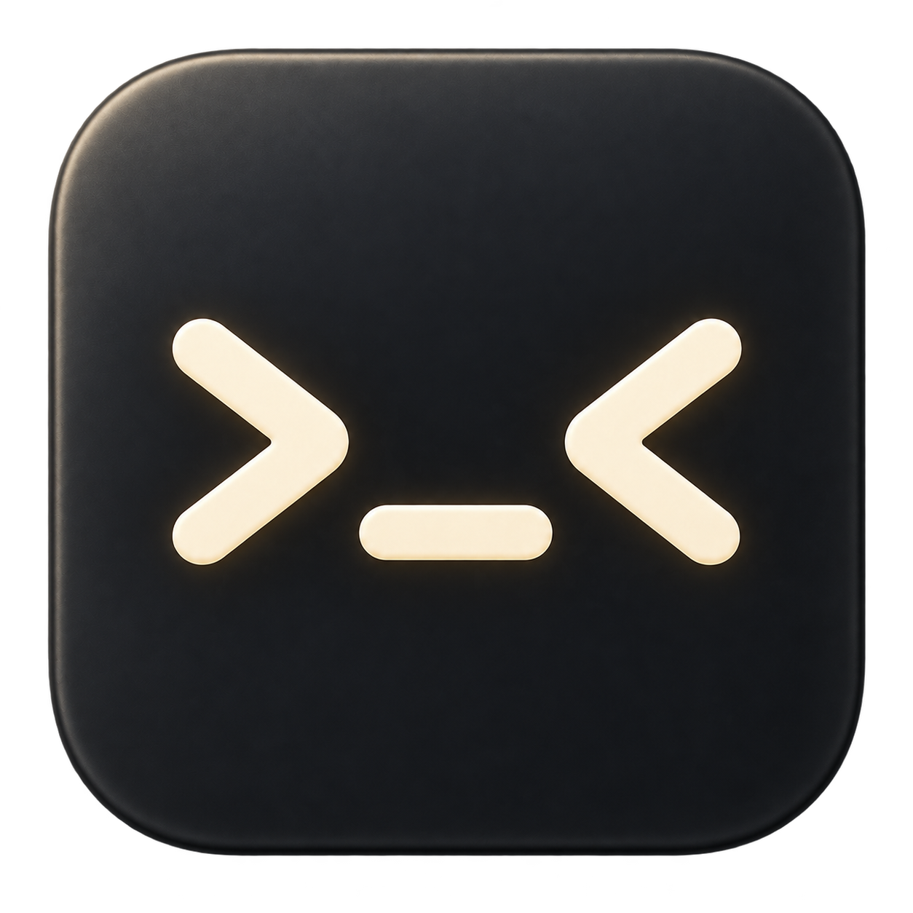
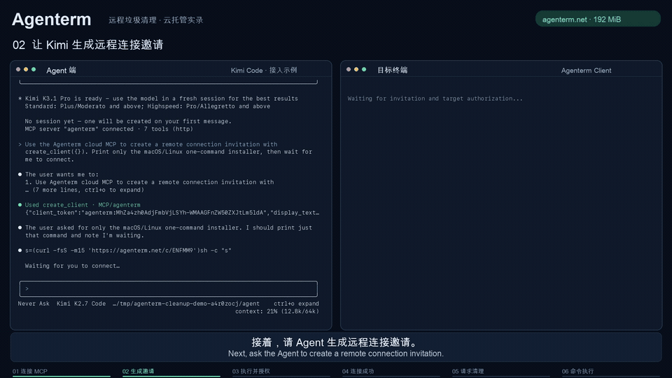

  
  <h1>Agenterm</h1>
  
<strong>Let an AI agent assist with a remote computer through an authorized terminal connection.</strong>

  

    
    
    
    
  

  
🔗 Multiple devices · ⚡ One-click connection · 🔓 No SSH required · 🤖 Agent-first

  

    <a href="#-quick-start">🚀 Quick start</a> ·
    <a href="https://github.com/Heming9/agenterm/releases">📥 Releases</a> ·
    <a href="docs/deployment.md">🏠 Self-host</a> ·
    <a href="README.zh-CN.md">简体中文</a>
  

  

<a href="docs/demo/README.md">Full demo and subtitles · 1:42</a>

## 🚀 Quick start

1. **Connect your agent.** Add `https://agenterm.net/mcp` to an agent that supports Streamable HTTP. [See configuration examples](docs/usage.md#connect-your-agent).
2. **Invite and authorize.** Ask the agent to create an invitation. Privately share the short link it returns or the connection command for the target computer's OS. Short links are available for single-device invitations when short codes are enabled. The recipient opens the link or runs the command on the target computer and authorizes access.
3. **Start assisting.** Once the device connects, tell the agent what to do. The recipient can see commands and output in the client and disconnect at any time.

Connections grant terminal access with the target computer's current user permissions. Only authorize people you trust. The server relays commands and output between the agent and the client without requiring an inbound port on the target computer. The hosted service allows public invitation creation and limits simultaneous device connections by the invitation creator's IP.

The current source uses the Rust CLI. The public [v0.10.17 prerelease](https://github.com/Heming9/agenterm/releases/tag/v0.10.17) still ships Go clients. For the hosted MCP service and released builds, consult the connected server's `tools/list` for its tool fields.

[User guide and troubleshooting](docs/usage.md) · [Self-hosting](docs/deployment.md) · [MCP tool reference](docs/mcp-tools.md) · [Report an issue](https://github.com/Heming9/agenterm/issues) · [Apache-2.0](LICENSE)
