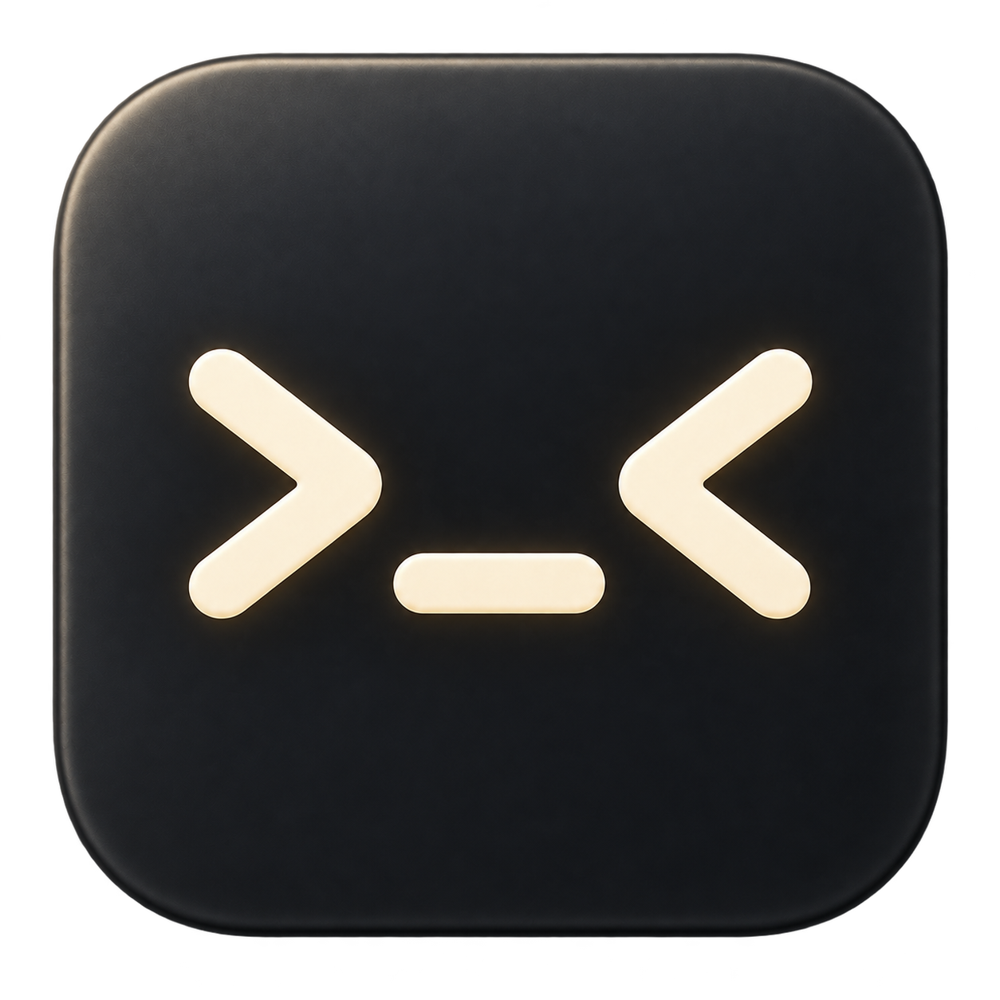
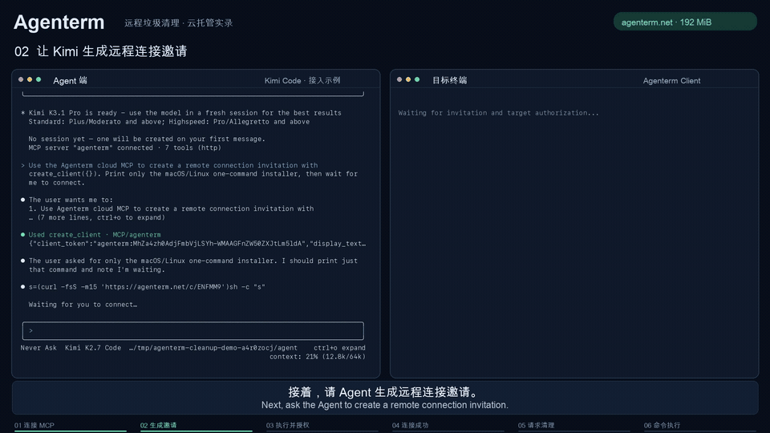
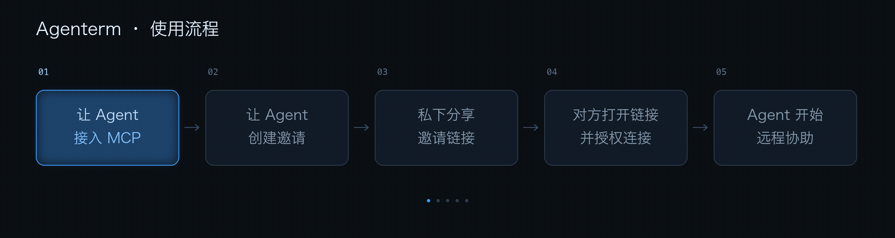
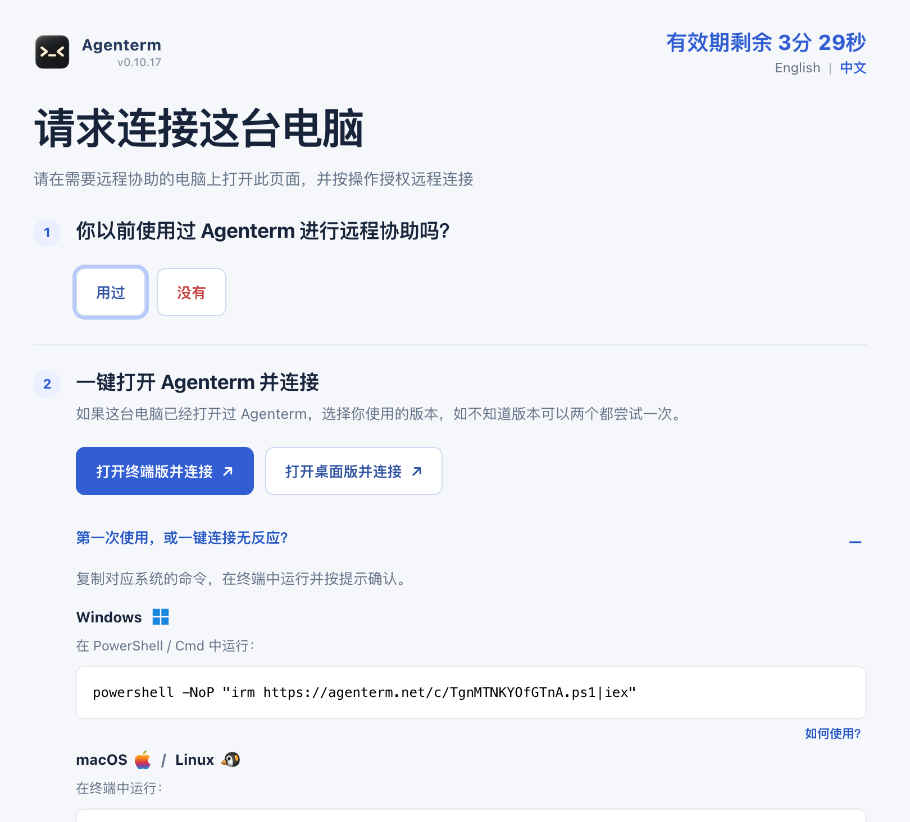
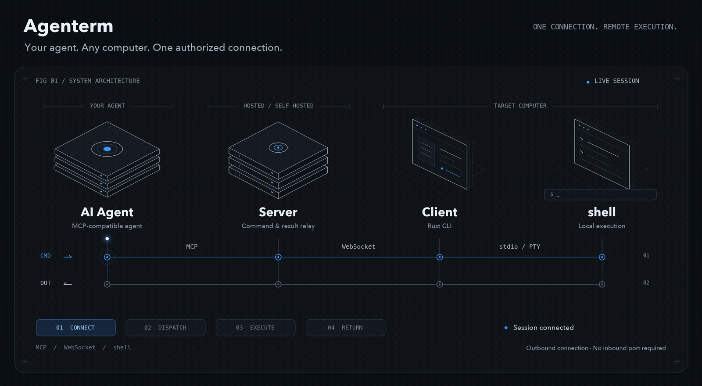

  
  <h1>Agenterm</h1>
  
<strong>通过一条授权命令，让 AI Agent 协助操作远程电脑。</strong>

  

    
    
    
    
  

  
🔗 多设备 · ⚡ 一键连接 · 🪶 轻量 · 🔓 无需 SSH · 🤖 Agent 优先

  

    <a href="#-快速开始">🚀 快速开始</a> ·
    <a href="https://github.com/Heming9/agenterm/releases">📥 下载客户端</a> ·
    <a href="docs/deployment.zh-CN.md">🏠 自托管</a> ·
    <a href="README.md">English</a>
  

  

生成邀请 → 确认授权 → 设备上线 → 执行任务

<a href="docs/demo/README.md">早期版本演示 · 1 分 42 秒 · 旧版终端界面</a>

## 🚀 快速开始

  

1. **接入 Agent：** 在支持 Streamable HTTP 的 Agent 中添加 MCP 服务 `https://agenterm.net/mcp`。[查看配置示例](docs/usage.zh-CN.md#接入-agent)
2. **邀请并授权：** 让 Agent 创建邀请，将短链接（例如 `https://agenterm.net/c/xef2k1`）私下发给对方。对方在需要协助的电脑上打开链接，按页面提示授权。若服务端未提供短链接，请分享对方系统对应的连接命令。
3. **开始协助：** 设备上线后，告诉 Agent 要完成的任务。对方可查看命令和输出，并随时断开。

  

将邀请页短链接发给对方，页面会引导对方完成远程授权。

连接授予目标电脑当前用户的终端权限，请只向信任的人授权。

## 💡 适合什么场景

- **帮助同事或客户排障：** 不用反复传递命令和输出，让 Agent 直接协助检查远程环境和日志。
- **帮助家人解决电脑问题：** 对方运行客户端并授权后，借助你熟悉的 Agent 进行终端协助。
- **操作另一台开发机或服务器：** 继续使用现有 Agent，无需在目标机器上配置完整 Agent 和模型账号。
- **协作检查多台电脑：** 连接几台测试机器，分别检查运行环境并汇总结果。

支持交互式终端任务。目标电脑使用 Rust CLI 查看执行过程，临时网络故障后客户端会自动尝试重连。

## 🔗 工作原理

  

终端命令和输出经 Server 转发。目标电脑授权后主动建立出站连接，无需开放入站端口。使用 P2P 传输文件时，两端另外建立直连，Server 负责信令协商。[文件传输说明](docs/usage.zh-CN.md#如何传输文件)

可以使用托管服务，也可以[部署自己的 Server](docs/deployment.zh-CN.md)。

## ❓ 常见问题

连接失败或邀请过期怎么办？

确认双方都能访问服务；如果邀请无法使用，让 Agent 重新创建。出现版本不兼容提示时，使用同一版本的服务端和客户端。[连接排查](docs/usage.zh-CN.md#连接失败或邀请过期)。

断线后会自动继续任务吗？

客户端会尝试重连，但不会自动重放命令。让 Agent 重新确认设备和任务状态；已经结束的 Agent 对话不会因设备上线而自动唤醒。

能操作远程桌面或连接多台电脑吗？

Agenterm 提供终端协助，不提供远程桌面。多设备任务可让 Agent 创建多设备邀请；Windows 支持简单输入交互，要求真实终端的全屏程序可能无法使用。

托管服务有什么限制？

目前无需管理认证，每个邀请创建者的 IP 仅允许有限的在线设备数量，Agent、Server 和目标客户端都能看到命令与输出，请妥善保管邀请和 token。自行部署到公网时使用 HTTPS。

[使用指南](docs/usage.zh-CN.md) · [部署与源码构建](docs/deployment.zh-CN.md) · [问题反馈](https://github.com/Heming9/agenterm/issues) · [Apache-2.0](LICENSE)
