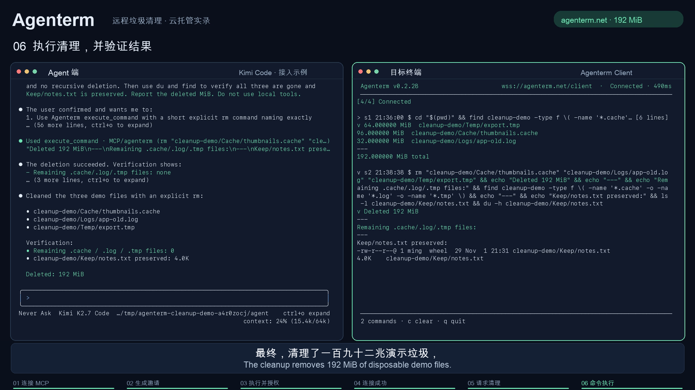

# Agenterm cloud demo / 云托管演示

[Video / 视频 (MP4)](agenterm-cleanup.mp4) · [Bilingual subtitles / 双语字幕 (SRT)](subtitles.zh-en.srt) · [Chinese narration script / 中文旁白文稿](narration.zh.txt)

## What the demo shows

The 1:42 video follows an MCP agent through Agenterm's hosted service: connect MCP, generate an invitation, run the one-command installer in the target terminal, authorize the connection, then scan, confirm, clean up, and verify disposable files. Kimi Code is one example of a compatible agent. The video includes Chinese narration, Chinese/English captions, background music, and reading pauses.

Both terminals ran in separate local demo directories on one computer; MCP and WebSocket traffic actually passed through `https://agenterm.net`. The cleanup removed three prepared files totaling 192 MiB (96 MiB cache, 32 MiB logs, and 64 MiB temporary data), while preserving `Keep/notes.txt`. The client was disconnected after recording.

## 演示说明

视频保留左右双终端，按“连接 MCP → 生成邀请 → 执行一键命令并授权 → 连接成功 → 请求清理 → 执行与验证”的顺序展示。Agenterm 为产品主角，Kimi Code 是兼容 MCP Agent 的接入示例。

两端在同一台电脑的独立演示目录运行，通信实际经过 Agenterm 云托管服务。按演示范围，仅创建并真实清理了 192 MiB 临时样例缓存、日志与临时文件，保留笔记文件。录制结束后客户端已断开。

## Media credits and usage

- **Narration:** Microsoft Edge online text-to-speech, `zh-CN-XiaoxiaoNeural`, through [edge-tts](https://github.com/rany2/edge-tts). The Chinese narration script is included above.
- **Music:** “Vastness” by **Andrew Ev**, from [Mixkit's ambient music catalogue](https://mixkit.co/free-stock-music/ambient/) (track 184), used under the [Mixkit Stock Music Free License](https://mixkit.co/license/#musicFree). The track is trimmed and faded to fit the video, with its volume reduced during narration.
- **Captions:** Chinese narration and English translation, timed using the online speech service's word-boundary metadata.

The music license permits use in commercial and non-commercial online videos, social media, and online marketing ads. It does not permit standalone music redistribution, music-only remixes, rights-management registration, video games, or TV/radio broadcasts. Consult the linked license for its complete terms. The music is used as part of this video and is not separately distributed in this repository.

Third-party music remains subject to its own license; the repository's Apache-2.0 license does not replace that license. Source and license information was checked on 2026-11-01.
